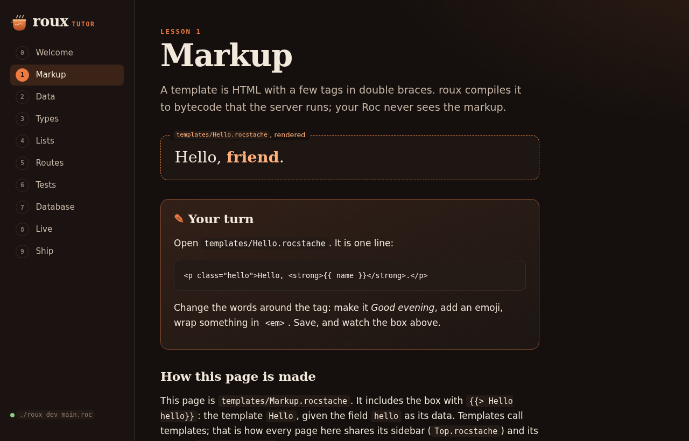

# roux tutor

Learn [roux](https://github.com/Eldhus/roux), a Roc platform for web apps, by changing the app that
teaches it.



On Linux 6.7 or later, on an x86-64-v3 CPU (AVX2: Intel Haswell, AMD Zen or newer):

```sh
git clone https://github.com/Eldhus/roux-tutor
cd roux-tutor
./roux dev main.roc
```

The first run downloads roux and the Roc compiler it uses into `.roux-tools/`

Open <http://localhost:8080> to find:

- a two minute intro to roux
- a live speed demo
- and a handful of deeper examples


## Working on it

With the app running, `node tests/idle.mjs` checks that every page stops drawing once it has
loaded: an endless animation costs a whole CPU core in a browser without GPU acceleration. It needs
Node 22 or later and Brave (or another Chromium, named by `BROWSER`).

Part of [Eldhus](https://github.com/Eldhus).
